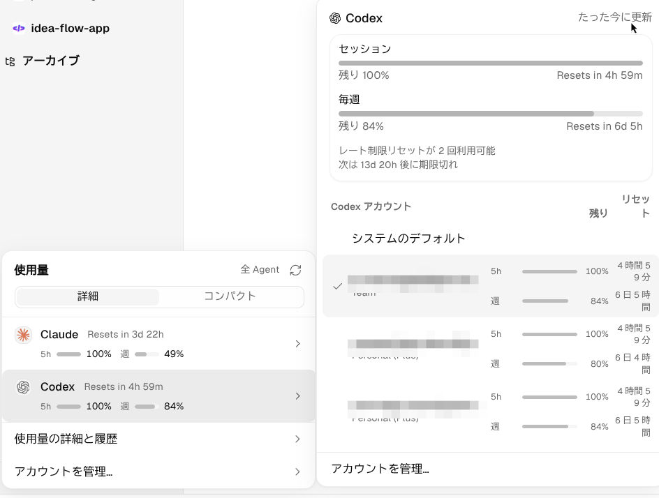

## はじめに

最近は Orca の上で Claude と Codex を複数動かしています。
Claude が作業を監督・レビューし、Codex が実装する形です。

Orca は複数の AI エージェントをワークツリーごとに動かせる IDE です。NixOS サーバー上で常駐させ、ノートPCからも同じチャットやワークツリーを使っています。

## Claude と Codex の役割分担

一番大きいのはこのルールです。

- **Claude**：要件の整理、方針の判断、Codex への指示、結果の確認、レビュー
- **Codex**：リポジトリ内のコードやテスト、設定ファイルを実際に書き換える

Claude 自身はコードを直接書かず、Orca 上で Codex のチャットを立てて作業を任せます。
終わったら Claude が差分を見て、型チェックやテストを流し、問題なければコミット、そして Codex のチャットを閉じる、という流れです。

こうしている理由は2つあります。

1. **レビューする側と書く側を分けたい**
   自分で書いたコードを自分でレビューすると甘くなりがちです。人間のチーム開発と同じで、別の目が入るほうが安心できます。
2. **使用量の枠を分散したい**
   出力の多い作業を Codex に寄せることで、Claude の枠を判断やレビューに使えます。

このルールは Claude のルールファイルに書き、毎回同じ流れで進めています。

## Codex の複数アカウント運用

Codex のアカウントを複数登録しているので、Orca の使用量表示で残量を確認できます。
一覧には、通常の非使用中アカウントに加え、現在使用中のアカウントも表示するようにしました。



起動時は `orca-codex-best` というラッパーでアカウントを選びます。
5時間枠と週間枠の両方に残量があり、使用量データが5分以内に更新されたアカウントだけを候補にします。その中で5時間枠の残量が最大のものを選びます。

```js
if (now - state.updatedAt > 300_000) continue;
if (state.session.windowMinutes !== 300) continue;
if (![state.session, state.weekly].every(w => w.usedPercent < 100)) continue;
candidates.sort((a, b) => b.remainingPercent - a.remainingPercent);
```

これは選択部分を短くした抜粋です。実際には取得状態やリセット時刻も確認し、有効な候補がなければ起動を止めます。

複数の Claude が同時に起動してもアカウント選択がぶつからないよう、Nix のラッパーでは `flock` で選択から起動までを直列化しています。切り替えた後は Orca に再問い合わせして、選んだアカウントが有効になったことも確認します。

```sh
orca-codex-best -- agent launch --agent codex --surface chat --json ...
```

`--json` では Orca の起動結果に選んだアカウントと残量を加えて返します。結果に含まれる `sessionId` は後続の指示や終了処理に使えます。同じ JSON を `${XDG_RUNTIME_DIR:-/tmp}/orca-codex-best-last.json` に保存するので、標準出力を取りこぼしても回収できます。

使用量表示には、Orca の minify された JavaScript を Python の正規表現で見つけてパッチを当てています。追加した JavaScript が使用中アカウントの使用量を一覧へ足します。パッチ対象の形が変わった場合は検出して止まる作りです。

Claude の運用ルールには、**起動 → 指示 → 差分・テスト確認 → コミット → チャットを閉じる** までを書いています。作業後は `orca-chat-close <sessionId>` で Codex のセッションとタブを閉じます。追加修正や調査が必要なときは残します。

## その他の Orca カスタマイズ

Orca 周辺の設定は NixOS の flake で管理しています。

| カスタマイズ | 内容 |
|---|---|
| 自動グループ分け | 開いているリポジトリなどを「よく使う」、それ以外を「アーカイブ」に移動 |
| ghq 自動登録 | `ghq get`、`clone`、`create` の成功後、リポジトリを Orca に登録 |
| マージ済みワークツリーの掃除 | マージ済み PR に紐づくワークツリーを整理 |
| PR タブのピン留め | ワークツリーを開いたとき、紐づく GitHub PR をブラウザタブで開いてピン留め |
| 設定の同期 | サーバー側の設定をエクスポートし、ノートPC側へ反映 |
| Linux のキーボードパッチ | Orca のキーボード操作を Linux 環境向けに調整 |
| ブラウザのリンク先グループ | チャットやターミナルのリンクを、元のグループのブラウザタブで開く |

## まとめ

Claude と Codex の役割を分け、Codex の起動時に残量のあるアカウントを自動で選ぶようにしました。
表示や後片付けも少し補うと、複数のエージェントを Orca 上で扱いやすくなります。

実装前の方針を人が確認する仕組みは、[akapen の記事](https://zenn.dev/mame77/articles/orca-akapen-workflow)で紹介しています。
